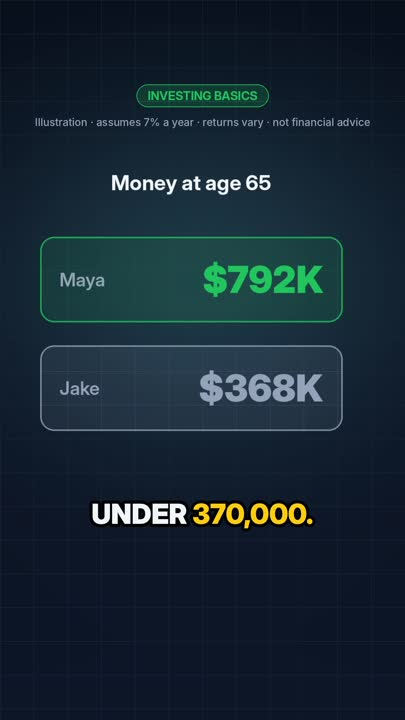
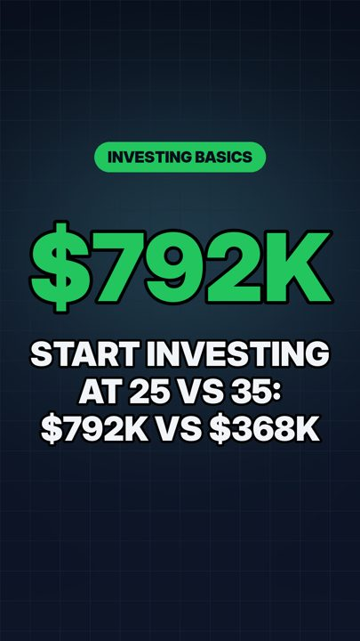
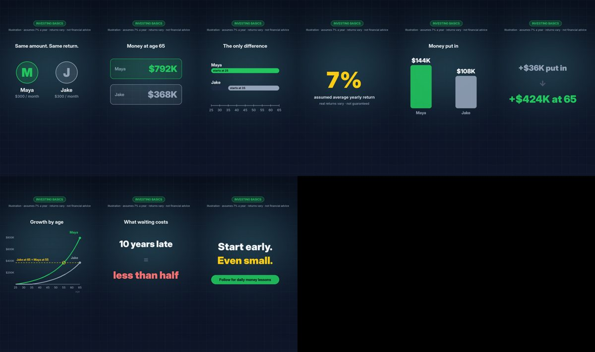
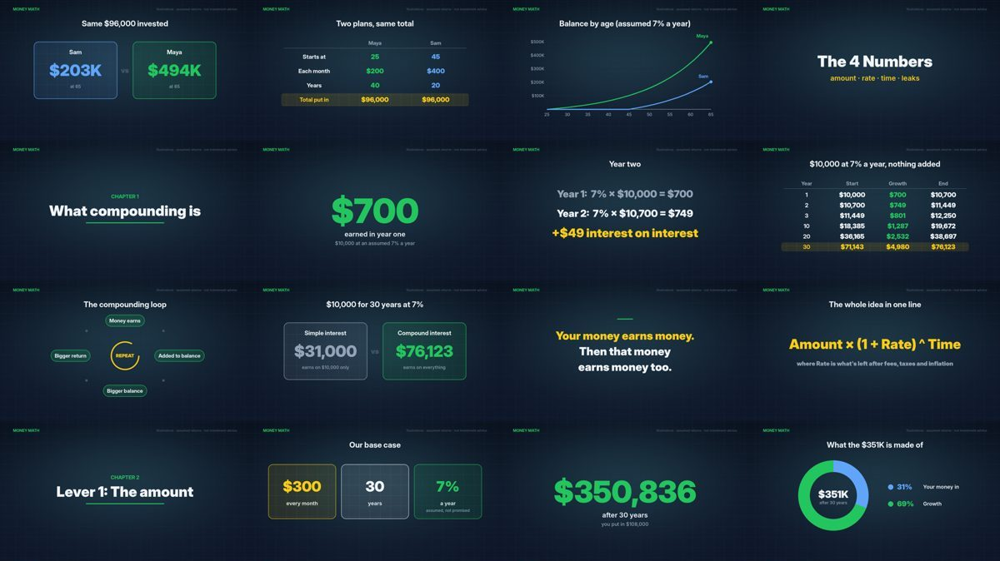

# Penny to Billion: automated finance video pipeline

[](https://github.com/aarushagrawal267-maker/money-channel/actions/workflows/tests.yml)

**Penny to Billion** is a faceless YouTube channel that teaches money basics: personal finance,
debt traps, how markets work, how companies make money, and business case studies.
This repository is the software that produces and publishes it: every video is written as a small
Python file whose numbers are checked by code, then turned into a fully animated video with an AI voice,
synced captions, original background music and a thumbnail, and uploaded on a schedule through the
YouTube Data API.

- Channel: https://www.youtube.com/channel/UC-DK-CcVvDnkZoehOWGWlBg (handle `@PennyToBillion`)
- Website, privacy policy and terms: https://aarushagrawal267-maker.github.io
  (repo [`aarushagrawal267-maker.github.io`](https://github.com/aarushagrawal267-maker/aarushagrawal267-maker.github.io))
- Output: 2 Shorts a day (1080x1920, ~35-50 s) + 3 long videos a week (1920x1080, 8-12 min)

| A Short, mid-video | Its auto-made thumbnail | Every scene of a Short (layout preview) |
|---|---|---|
|  |  |  |

Long video scene preview (first 16 of 57 scenes of `L002_compounding`):



## Features

- **Numbers you can trust.** Each video is a spec file (`pipeline/specs/<id>.py`). Every spoken or shown
  number is computed in Python and guarded by `assert`s (or is a sourced constant with the source in the
  description). If a number in the script is wrong, the spec refuses to build.
- **Two renderers, 27 animated visual types.** Shorts: pair, compare, timeline, stat, bars, equation, line, cta.
  Long videos: chapter, title, stat, count, stat_grid, hbars, share, flywheel, bullets, equation, line, cta,
  waterfall, donut, columns, versus, timeline, quote, table. All drawn frame by frame with Pillow and
  encoded with ffmpeg (H.264 + AAC, loudness-normalised to -14 LUFS).
- **Offline AI voice:** Kokoro text-to-speech (`kokoro-onnx`, voice `af_heart`), no paid API.
- **Word-synced captions:** faster-whisper finds when each word is spoken; spoken numbers are shown
  as digits ("seven hundred ninety-two thousand dollars" becomes `$792,000`). Falls back to estimated timing.
- **Original music:** a procedurally generated ambient track, different tempo and chords per video (no licensing).
- **Thumbnails and chapters:** generated automatically; long videos get a chapter list for the description.
- **Voice check:** `tools/voice_check.py` transcribes the finished audio and diffs it against the script to
  catch mispronunciations.
- **Safe uploads:** `pipeline/upload.py` does resumable uploads with retry, scheduled publishing
  (`publishAt`), category, made-for-kids flag, tags, hashtags, an AI-assistance disclosure, and translated
  titles/descriptions in 6 languages (es, pt, hi, id, de, fr). It logs every upload to `pipeline/posted.json` the moment it
  succeeds and refuses to upload the same video twice; `tools/upload_pending.sh` also checks the live
  channel's titles before uploading.
- **Content planning:** `pipeline/queue.json` (67 topics across 7 pillars), `pipeline/schedule.txt`
  (publish slots), `CONTENT_PLAN.md` (strategy), `docs/AUTOPILOT.md` (weekly runbook), `docs/reviews/`
  (fact-check, SEO, compliance, code and editing reviews).

## How it works

```
pipeline/specs/018_start_early_us.py   --(asserts check every number)-->   018_start_early_us.json
        |
        v
pipeline/render.py  (Shorts)  or  pipeline/render_long.py  (long videos)
   1. Kokoro TTS speaks each scene  ->  voice track + scene timeline
   2. procedural music mixed under the voice
   3. faster-whisper word timestamps  ->  captions (numbers as digits)
   4. each frame drawn with Pillow (background, badge, disclaimer, animated visual, captions)
   5. frames piped into ffmpeg -> output/<id>.mp4 (+ thumbnail, + chapters for long videos)
        |
        v
tools/voice_check.py (pronunciation diff)  ->  pipeline/upload.py  ->  YouTube (scheduled)  ->  posted.json
```

## Setup

Needs Linux or macOS, Python 3.10+, `ffmpeg`, and the Inter font (`fonts-inter` on Debian/Ubuntu).

```bash
git clone https://github.com/aarushagrawal267-maker/money-channel.git
cd money-channel
sudo apt-get install -y ffmpeg fonts-inter   # if not already installed
./setup.sh        # pip install -r requirements.txt + downloads the Kokoro voice model (~350 MB) into models/
```

The first render also downloads the Whisper `base.en` model (~150 MB) into the Hugging Face cache.

## Usage

```bash
# 1. Build (and check) a spec. Fails loudly if any number is wrong.
cd pipeline/specs && python3 018_start_early_us.py && cd ../..

# 2. Look at every scene in a few seconds (no voice needed)
python3 pipeline/preview.py pipeline/specs/018_start_early_us.json output/preview

# 3. Render the video (Short ~1-3 min, long video ~10 min on 4 CPUs)
tools/render_batch.sh 018_start_early_us          # -> output/018_start_early_us.mp4 + _thumb.png
tools/render_batch.sh L002_compounding            # -> output/L002_compounding.mp4 + chapters + thumbnail

# 4. Check pronunciation
python3 tools/voice_check.py pipeline/specs/018_start_early_us.json output/work_018_start_early_us/work/audio.wav

# 5. Upload (needs YouTube credentials, see below). --dry-run prints the metadata without uploading.
python3 pipeline/upload.py pipeline/specs/018_start_early_us.json output/018_start_early_us.mp4 \
    --thumb output/018_start_early_us_thumb.png --publish-at 2026-12-01T06:30:00+05:30 --dry-run

# Upload everything in pipeline/schedule.txt that is not on the channel yet (renders if needed)
tools/upload_pending.sh
# Re-try thumbnails that failed during upload
python3 tools/retry_thumbs.py
```

`render_batch.sh` stores a SHA-256 of the spec next to each video, so it re-renders only when the spec changed.

### YouTube credentials

`tools/get_youtube_token.py` runs the one-time Google OAuth flow. The three values it produces are read
from environment variables `YT_CLIENT_ID`, `YT_CLIENT_SECRET`, `YT_REFRESH_TOKEN` and are never stored in
this repo or printed. Step-by-step instructions are in `SETUP_GUIDE.md`.

## Tests

```bash
python3 -m pip install -r requirements-dev.txt
python3 -m pytest -q tests
```

The suite (no voice model or YouTube login needed) re-runs every spec's number checks and confirms the
committed JSON is up to date, validates every spec against the renderers and YouTube's metadata limits,
draws every scene of sample Shorts and a long video, tests the money/caption/music helpers, the upload
metadata builder, schedule parsing, retry policy and the upload log, and checks that `queue.json`,
`schedule.txt` and `posted.json` agree. It also runs on GitHub Actions (`.github/workflows/tests.yml`).

## Tech stack

Python 3 - NumPy - Pillow (frame drawing) - ffmpeg (H.264/AAC encoding, loudness normalisation) -
kokoro-onnx + ONNX Runtime (text-to-speech) - faster-whisper (word timestamps) - soundfile -
Google API Python client + OAuth 2.0 (YouTube Data API v3) - Bash - pytest - GitHub Actions - GitHub Pages (website).

## Project structure

| Path | What it is |
|---|---|
| `pipeline/specs/*.py` / `.json` | One file per video: script, visuals, title, description, tags, translations, number checks (28 Shorts, 6 long videos) |
| `pipeline/render.py` | Short renderer (1080x1920) + shared helpers: voice, music, captions, thumbnails |
| `pipeline/render_long.py` | Long-video renderer (1920x1080), chapters and thumbnail |
| `pipeline/preview.py` | Contact sheet of every scene, for fast layout checks |
| `pipeline/upload.py` | YouTube uploader (resumable, scheduled, logged) |
| `pipeline/queue.json`, `schedule.txt`, `posted.json`, `short_thumbs.json` | Topic queue, publish slots, upload log, thumbnail overrides |
| `tools/` | `render_batch.sh`, `upload_pending.sh`, `retry_thumbs.py`, `voice_check.py`, `seo_live.py` (titles/playlists on live videos), `channel_titles.py`, `get_youtube_token.py`, branding generators (`branding_v4.py` is current) |
| `branding_v4/` | Current logo, banner, watermark, channel description (`branding/`, `branding_v3/` are the older "Money Mechanics" set) |
| `site/` | Copy of the website (homepage, privacy policy, terms) served from the Pages repo |
| `docs/` | Autopilot runbook, owner Studio steps, YouTube API audit answers, specialist reviews, screenshots |
| `tests/` | pytest suite |
| `CONTENT_PLAN.md`, `SETUP_GUIDE.md`, `CLAUDE.md` | Strategy, channel/API setup guide, working notes |

## Limitations

- Rendering is CPU-only and slow-ish: about 1-3 minutes per Short and ~10 minutes per long video on 4 cores.
- The free YouTube API quota allows only a limited number of uploads per day, and YouTube also applies a
  rolling daily upload limit (about 10 in 24 hours for this channel); `upload_pending.sh` stops cleanly and resumes later.
- Editing or deleting a video after upload, and playlists, need the `youtube.force-ssl` permission
  (`tools/seo_live.py check` tells you whether the saved token has it).
- The Kokoro voice sometimes mispronounces brand names and acronyms; scripts work around known cases
  (see `CLAUDE.md`) and `voice_check.py` must be read after each render.
- English only for narration; titles and descriptions are translated.
- Content is general education, not financial advice; figures are as of the dates in each spec.

## License

Code: MIT (see `LICENSE`). Channel name, branding, scripts and videos: all rights reserved.
